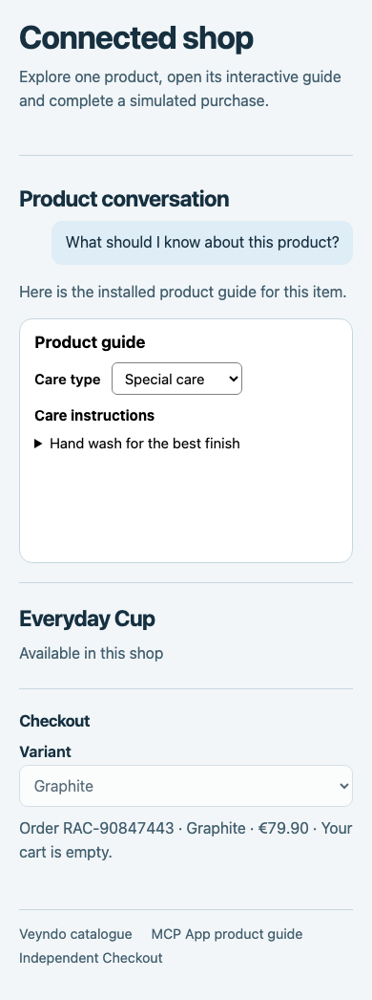
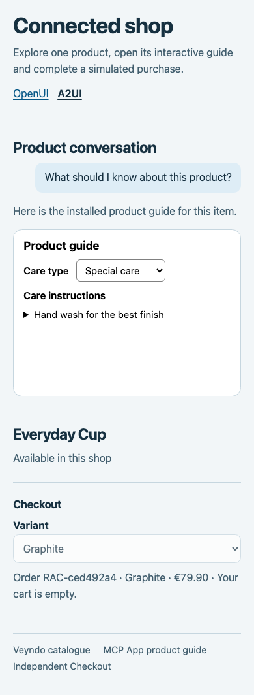
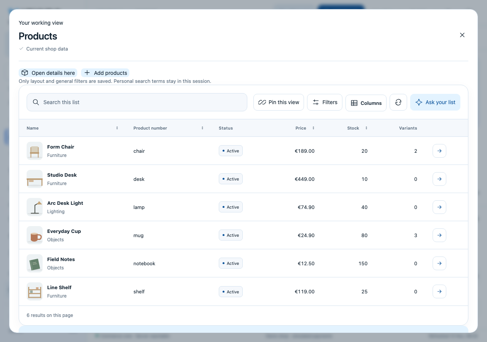
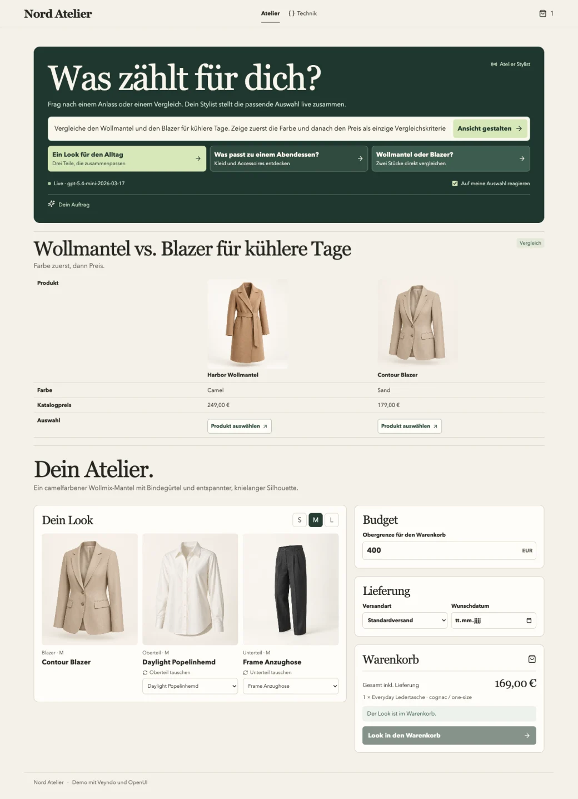

# Veyndo Commerce SDK

Build a storefront, a buyer account or a merchant tool in JavaScript or
TypeScript. Read live catalog data, connect checkout and give your interface
access to the same scoped operations that Veyndo exposes to apps and agents.

[Install and try it](#use-veyndo-as-a-hosted-api) ·
[Build something](#what-you-can-build) ·
[See the interfaces](#interactive-interfaces) ·
[Integration recipes](docs/integration-recipes.md) ·
[Release 0.4.25](https://github.com/veyndo/sdk/releases/tag/v0.4.25)

## Use Veyndo as a hosted API

Install the SDK and call the public demo from Node 22 or newer.

```sh
npm install https://github.com/veyndo/sdk/releases/download/v0.4.25/veyndo-sdk-0.4.25.tgz
node node_modules/@veyndo/sdk/examples/hosted-shop.mjs
```

```js
import { createHostedShop } from '@veyndo/sdk/hosted';

const { catalog, checkout } = createHostedShop({
  shop: 'lumen-story-lab-15-o-98aa4751fa',
  locale: 'en-GB',
});
const { elements } = await catalog.list({ limit: 3 });
console.log(elements.map(product => product.name));
console.log((await checkout.options()).payments.map(method => method.name));
```

The client uses the hosted API origin with one shop scope for catalog, checkout,
buyer account and MCP. [Connect your own shop, use a key, or set an API origin](docs/hosted-api.md).

## Where the SDK fits

Your storefront or agent uses the SDK to reach Veyndo through HTTP and MCP.
Commerce Core supplies the current prices and stock and records the order.
Checkout manages buyer sessions and receipt recovery. An app can return an
interactive UI through MCP while using the same shop's data and permissions.
[Follow an illustrated purchase and explore the components](https://www.veyndo.ai/docs/one-shop-components.html).

## Read the Store API catalog

With Node 22 or newer, install the published package and query the public Lumen
demo. The example reads a product, its price and the next catalog page. It
works without an API key.

```sh
npm install https://github.com/veyndo/sdk/releases/download/v0.4.25/veyndo-sdk-0.4.25.tgz
node node_modules/@veyndo/sdk/examples/store-catalog.mjs
```

Use the same client in your application:

```js
import { createCatalogClient } from '@veyndo/sdk/catalog';

const catalog = createCatalogClient({
  baseUrl: 'https://app.veyndo.ai',
  shop: 'lumen-story-lab-15-o-98aa4751fa',
  locale: 'en-GB',
});
const { elements: [first] } = await catalog.list({ limit: 1 });
if (first) {
  const { product, currencyContext } = await catalog.detail(first.id);
  console.log(product.name, product.price, currencyContext.code);
}
```

Run `node node_modules/@veyndo/sdk/examples/browser.mjs` and open the printed
local address to search, paginate and open products in a browser.
[Catalog recipe](docs/integration-recipes.md#read-the-store-api-catalog) ·
[Browser example](examples/browser.mjs)

## What you can build

| I want to build… | Use | Start with |
| --- | --- | --- |
| A custom storefront or product browser | `@veyndo/sdk/catalog` | [Load languages, currencies and category navigation](docs/hosted-api.md#build-your-storefront-navigation) · [Read products, variants, prices and availability](examples/store-catalog.mjs) |
| A checkout on my own storefront | `@veyndo/sdk/checkout` | [Address form](docs/integration-recipes.md#build-the-checkout-address-form) · [Coupons and currency](docs/integration-recipes.md#apply-coupon-codes-and-switch-currency) · [Terms](docs/integration-recipes.md#show-the-terms-and-record-the-buyers-decision) · [Confirm and recover a purchase](docs/integration-recipes.md#use-the-checkout-relay) · [Check a provider payment](docs/integration-recipes.md#check-the-payment-after-buyer-approval) · [Place an invoice order](docs/integration-recipes.md#place-an-invoice-order-and-show-payment-instructions) |
| A buyer account | `@veyndo/sdk/account` | [Sign in from your backend](docs/integration-recipes.md#sign-in-buyers-from-your-backend) · [Manage addresses, read orders and download receipts](docs/integration-recipes.md#read-the-buyers-order-history) |
| A product guide or an interactive merchant tool in chat | HTTP/MCP client and MCP App resources | [Discover a tool, read its UI resource and handle interaction](docs/mcp-apps.md) |
| A workspace assembled from multiple services | `@veyndo/sdk/composition` and `@veyndo/sdk/a2ui` | [Combine scoped reads and render the approved layout](docs/composition.md#render-an-admitted-workspace-with-a2ui) |
| An installable Veyndo extension | App Studio and the app manifest | [Build a package with its own data, actions, permissions and views](https://www.veyndo.ai/docs/app-tutorials/README.html) |
| A catalog or document assistant | `@veyndo/sdk/knowledge` | [Ingest and retrieve from the standalone Knowledge service](docs/integration-recipes.md#use-standalone-knowledge) |
| A merchant tool that previews automation | HTTP/MCP client | [Validate a Flow draft using the shop's permissions](docs/integration-recipes.md#check-a-flow-draft) |

## Interactive interfaces

### Connected Shop · OpenUI and A2UI

This external storefront reads a Veyndo product and its variants, opens the
installed Product Guide inside the conversation, then reviews and confirms a
simulated purchase through the separate Checkout service. Both renderers place
the same registered panels. Veyndo supplies the variant, price, delivery and
receipt.

<table>
<tr><th>OpenUI</th><th>A2UI</th></tr>
<tr>
<td></td>
<td></td>
</tr>
</table>

The captures are from local browser runs with simulated payments. The guide card is
an MCP App. OpenUI and A2UI arrange the host panels around it.
[Run Connected Shop](examples/connected-shop/README.md) ·
[Browser evidence](https://www.veyndo.ai/docs/status.html#a2ui-workspace-adapter-in-sdk-0415)

### Studio · A2UI working view

A reviewed assistant proposal opens the shop's native product workspace with
search, filters and edit controls. Studio projects the layout through the same
SDK adapter available to external hosts. The registered controls read and edit
products under the current merchant's permissions.

[](https://www.veyndo.ai/docs/status.html#a2ui-working-views-in-studio)

[Render an A2UI workspace](docs/composition.md#render-an-admitted-workspace-with-a2ui) ·
[Try it in Studio](https://www.veyndo.ai/docs/agentic-component-ui.html#open-an-a2ui-working-view-in-studio)

### Nord Atelier · storefront sections generated live

A shopper asks to compare a coat and a blazer by color and price. The
experiment streams a comparison from a real model response, renders it with
OpenUI and binds the items to the Veyndo catalog. The SDK reads product data
and calls Veyndo for cart review. The browser experiment went through a
confirmed cart addition.

[](docs/nord-atelier.md)

[See the experiment and run the SDK cart excerpt](docs/nord-atelier.md)

## Connect HTTP and MCP

Use the base client to discover and call MCP tools or to send HTTP requests.
Shop selection and credentials travel with the request. Veyndo checks the
current shop, actor and permissions on the server. Keep integration and agent
keys in your server environment. Buyer-facing clients can use the current
shop session.

```js
import { createClient } from '@veyndo/sdk';

const client = createClient({
  baseUrl: process.env.VEYNDO_URL,
  shop: process.env.VEYNDO_SHOP,
  token: () => process.env.VEYNDO_TOKEN,
});
await client.initialize();
const availableTools = await client.tools();
const products = await client.tool('catalog.search', { query: 'chair' });
```

[HTTP and MCP recipe](docs/integration-recipes.md#http-and-mcp-from-node) ·
[Independent host exchange](docs/integration-recipes.md#independent-host-exchange) ·
[Recover after an uncertain write](docs/integration-recipes.md#errors-and-repeated-writes)

The SDK has no runtime dependencies. It includes generated operation types,
OpenAPI and WIT contracts. Veyndo also publishes a
[component map](https://www.veyndo.ai/docs/one-shop-components.html) with the
interfaces and running examples for the separate services.

## Develop the SDK

```sh
npm ci
npm run check
npm test
npm run test:types
```

[Contract sources and verification](docs/integration-recipes.md#contracts-provenance-and-tests) ·
[License](LICENSE) · [Security](SECURITY.md)
